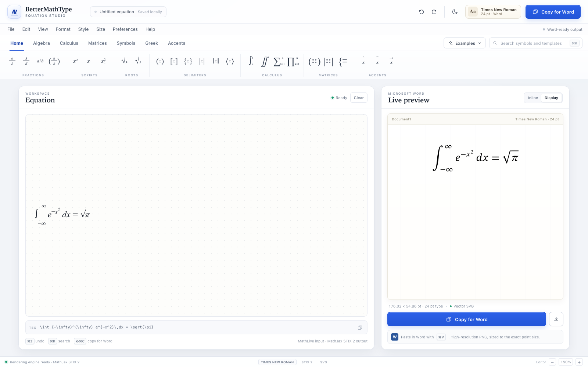
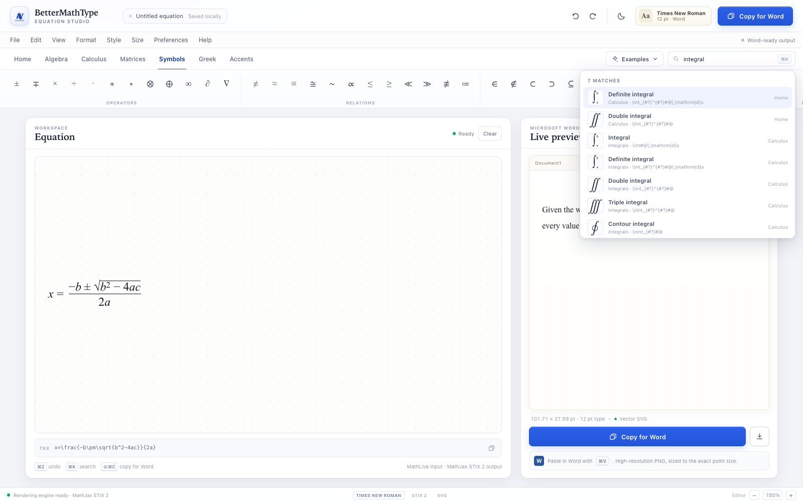
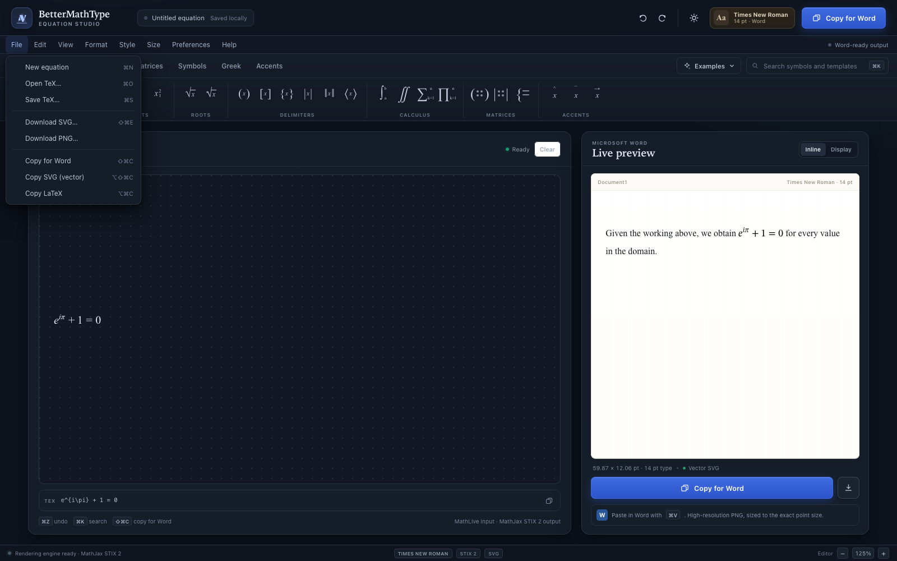
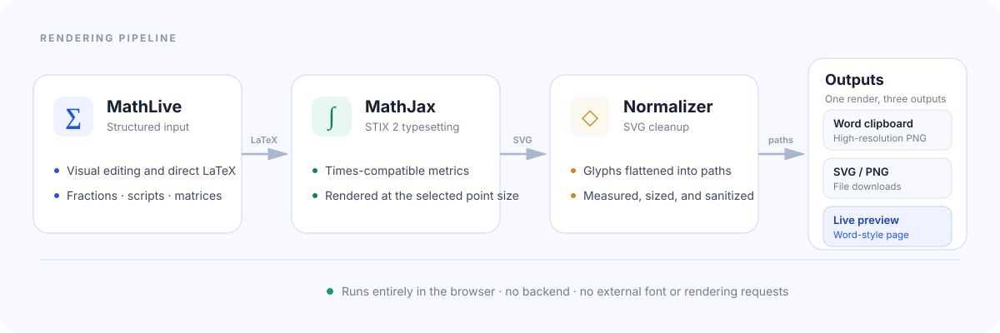

<p align="center">
  
</p>

<h1 align="center">BetterMathType</h1>

<p align="center">
  <strong>An open-source, MathType-inspired equation editor with Word-ready output.</strong><br />
  Write LaTeX, preview it at true point size, and paste crisp equations into Microsoft Word.
</p>

<p align="center">
  <a href="https://github.com/mki169/bettermathtype/actions/workflows/ci.yml"></a>
  <a href="https://vite.dev"></a>
  <a href="https://mathlive.io"></a>
  <a href="https://www.mathjax.org"></a>
  
  <a href="LICENSE"></a>
  <a href="CONTRIBUTING.md"></a>
  <a href="docs/TRANSLATING.md"></a>
  <a href="https://github.com/mki169/bettermathtype"></a>
</p>

<p align="center">
  <a href="https://vercel.com/new/clone?repository-url=https%3A%2F%2Fgithub.com%2Fmki169%2Fbettermathtype"></a>
</p>

<p align="center">
  <picture>
    <source media="(prefers-color-scheme: dark)" srcset="docs/screenshots/dark.png" />
    <source media="(prefers-color-scheme: light)" srcset="docs/screenshots/light.png" />
    
  </picture>
</p>

> The Microsoft Word preview intentionally stays paper-white in both themes, so what you see matches what you paste.

## Why I built this

MathType is a paid product, and my trial expired. That was the trigger, but the bigger issue was the fit. For the simple loop I actually use — type an equation, choose a point size, copy it, and paste it into Word — the editor felt heavy and laggy.

The core idea is simple. I did not need a full desktop suite, a subscription, or a trial timer to put an equation in a document. So I built the tool I wanted:

- fast to open
- keyboard-friendly
- high-resolution Word output
- available in the browser
- free and open source

BetterMathType is not trying to recreate every advanced MathType workflow. It focuses on the one job I do most. That is where this repo came from.

If it saves you time, please [star the repository](https://github.com/mki169/bettermathtype). It helps other people find it.

## Contents

- [Why I built this](#why-i-built-this)
- [Features](#features)
- [Gallery](#gallery)
- [Quick start](#quick-start)
- [Usage](#usage)
- [Keyboard shortcuts](#keyboard-shortcuts)
- [How it works](#how-it-works)
- [Deployment](#deployment)
- [Browser support](#browser-support)
- [Privacy](#privacy)
- [Project structure](#project-structure)
- [Security](#security)
- [Translations](#translations)
- [Contributing](#contributing)
- [Star history](#star-history)
- [License](#license)
- [Acknowledgements](#acknowledgements)

## Features

- **Word-first output.** MathJax renders equations with the STIX 2 font, and the app flattens glyphs into SVG paths. The Word clipboard receives a high-resolution PNG sized to the chosen point size, so Word needs no special fonts. SVG remains available for vector workflows.
- **True point sizes.** Choose 10–36 pt and see the output dimensions before copying. The preview is measured against the Word-style page.
- **MathType-style workflow.** A ribbon of fractions, scripts, roots, delimiters, calculus, matrices, symbols, Greek letters, and accents, plus examples and symbol search.
- **Visual and LaTeX input.** Edit structure with MathLive or type LaTeX directly. Smart fences and smart superscript are enabled by default.
- **Vector and raster export.** Copy for Word as a high-resolution PNG, copy or download the raw SVG, export PNG, and copy the LaTeX source.
- **Private by design.** Everything runs locally in the browser. There is no backend, account, analytics, or network dependency.
- **Dark mode.** Follows the operating system by default, with a persistent manual override.
- **Keyboard-driven.** Undo, redo, search, export, and clipboard actions all have shortcuts.

## Gallery

<p align="center">
  
</p>
<p align="center"><em>Display equations at the selected point size against a Word-style page.</em></p>

<p align="center">
  
  
</p>
<p align="center"><em>Search every symbol and template from the ribbon, and copy or export from the File menu. Dark mode included.</em></p>

## Quick start

Requirements: Node.js `^20.19.0` or `>=22.12.0` (required by Vite 8) and npm.

```bash
git clone https://github.com/mki169/bettermathtype.git
cd bettermathtype
npm install
npm run dev
```

Open `http://localhost:5173`.

Build and preview the production bundle:

```bash
npm run build
npm run preview
```

The build is written to `dist/`. Preview serves it at `http://localhost:4173` by default.

## Usage

1. Type LaTeX into the equation field, or insert symbols and templates from the ribbon.
2. Choose an output size from **Size** and an inline or display layout from the preview controls.
3. Check the result against the live Word page. The measured width and height are shown below it.
4. Select **Copy for Word** to place a high-resolution equation image on the clipboard.
5. Paste into Microsoft Word with `Cmd+V` on macOS or `Ctrl+V` on Windows.

The same output is available from the **File** menu as SVG, PNG, LaTeX, or a vector clipboard copy. Recent equations are kept locally for quick reuse.

> Image clipboard access requires a secure context (`https://` or `localhost`). If a browser blocks it, BetterMathType opens a fallback dialog with the SVG source and a download button.

## Keyboard shortcuts

| Action | macOS | Windows / Linux |
| --- | --- | --- |
| Open symbol search | `Cmd+K` | `Ctrl+K` |
| Copy for Word | `Shift+Cmd+C` | `Ctrl+Shift+C` |
| Copy SVG (vector) | `Option+Shift+Cmd+C` | `Ctrl+Alt+Shift+C` |
| Copy LaTeX | `Option+Cmd+C` | `Ctrl+Alt+C` |
| Download SVG | `Shift+Cmd+E` | `Ctrl+Shift+E` |
| Save TeX | `Cmd+S` | `Ctrl+S` |
| Open TeX | `Cmd+O` | `Ctrl+O` |
| New equation | `Cmd+N` | `Ctrl+N` |
| Clear equation | `Cmd+Backspace` | `Ctrl+Backspace` |
| Reset editor zoom | `Cmd+0` | `Ctrl+0` |
| Show shortcuts | `?` | `?` |

Undo and redo use the editor's native `Cmd+Z` / `Ctrl+Z` and `Shift+Cmd+Z` / `Ctrl+Shift+Z`.

## How it works

<p align="center">
  
</p>

1. **Input.** MathLive maintains the structured equation and exposes its LaTeX source.
2. **Typesetting.** MathJax renders the expression with STIX 2, a Times-compatible math font, at the selected point size.
3. **Normalization.** The generated SVG is measured, sanitized, given explicit dimensions, and its `<use>` glyph references are flattened into paths.
4. **Output.** The SVG feeds the live preview and SVG/PNG downloads. For Word, it is rasterized to a high-resolution PNG at the selected point size and placed on the clipboard.

All rendering happens in the browser. There is no server component and no external font or rendering request.

## Deployment

The app is a static single-page site. Both platforms use the same build settings:

| Setting | Value |
| --- | --- |
| Build command | `npm run build` |
| Output directory | `dist` |
| Framework preset | Vite |
| Environment variables | None |

The site must be served from a domain root, not a subpath. Asset URLs (`/assets`, `/vendor`, `/mathlive-fonts`) are absolute, so `https://example.com/` works while `https://example.com/app/` does not without changing Vite's `base`.

### Vercel

[](https://vercel.com/new/clone?repository-url=https%3A%2F%2Fgithub.com%2Fmki169%2Fbettermathtype)

The button clones this repository into your own Git account. If it does not work for you, import it manually:

1. In Vercel, choose **Add New → Project** and import the repository.
2. Confirm **Framework Preset: Vite**, **Build Command: `npm run build`**, and **Output Directory: `dist`**.
3. Select **Deploy**.

Or deploy from the command line:

```bash
npx vercel
npx vercel --prod
```

No `vercel.json` is required because the app has no client-side routes. The Hobby plan is free for personal, non-commercial use and includes 100 GB of fast data transfer and 100 deployments per day.

Documentation: [Vite on Vercel](https://vercel.com/docs/frameworks/frontend/vite) and [Hobby plan limits](https://vercel.com/docs/plans/hobby).

### Cloudflare Pages

Cloudflare does not provide a one-click Deploy button for Pages; its Deploy button supports Workers only. Use the dashboard flow instead:

1. Go to **Workers & Pages → Create application → Pages → Connect to Git**.
2. Authorize GitHub, select the repository, and set the production branch to `main`.
3. Use **Framework preset: Vite** if listed, otherwise **None**.
4. Set **Build command** to `npm run build` and **Build output directory** to `dist`.
5. Select **Save and Deploy**.

The current Pages build image defaults to Node.js 22, which satisfies Vite 8. If you pin an older image, set `NODE_VERSION=22` in the project's environment variables.

Direct upload without Git integration:

```bash
npm run build
npx wrangler pages deploy dist --project-name bettermathtype
```

Direct Upload projects cannot be converted to Git integration later. Prefer Git integration for continuous deployment.

Free-plan limits relevant to this project: 500 builds per month, 20,000 files, and 25 MiB per file. The largest asset, the MathJax bundle, is about 2.1 MB.

Documentation: [Git integration](https://developers.cloudflare.com/pages/get-started/git-integration/), [Build configuration](https://developers.cloudflare.com/pages/configuration/build-configuration/), [Direct Upload](https://developers.cloudflare.com/pages/get-started/direct-upload/), and [Limits](https://developers.cloudflare.com/pages/platform/limits/).

## Browser support

BetterMathType targets current evergreen browsers:

- Chrome and Edge (latest)
- Firefox (latest)
- Safari 16.4 or newer

The app uses ES modules, `<dialog>`, `matchMedia`, `localStorage`, and the asynchronous clipboard API. Image clipboard support is best in Chromium-based browsers; Safari and Firefox may use the manual SVG fallback. A secure context is required for clipboard writes.

## Privacy

All equations and preferences stay in the browser. There are no accounts, cookies, analytics, or telemetry. The app uses three `localStorage` keys:

- `bettermathtype:document` — current equation and editor preferences
- `bettermathtype:recent` — recent equations
- `bettermathtype:theme` — explicit light or dark theme choice

Use **Preferences → Clear local data** to remove the document and recent history.

## Project structure

```text
.
├── .editorconfig
├── .gitattributes
├── .github/
│   ├── ISSUE_TEMPLATE/     Bug, feature, translation, and security links
│   ├── workflows/          CI, CodeQL, and dependency review
│   ├── CODEOWNERS
│   ├── dependabot.yml
│   └── PULL_REQUEST_TEMPLATE.md
├── .gitignore
├── .nvmrc
├── docs/
│   ├── screenshots/        README gallery screenshots
│   ├── architecture.svg    Rendering pipeline diagram
│   └── TRANSLATING.md      Translation guide
├── public/
│   ├── favicon.svg
│   ├── mathlive-fonts/     Self-hosted MathLive fonts
│   └── vendor/             Prebuilt MathJax STIX 2 bundle
├── src/
│   ├── main.js             Editor, rendering, export, persistence, and theme logic
│   ├── toolbar.js          Ribbon tabs, symbol groups, and examples
│   └── styles.css          Application styles and dark theme overrides
├── CONTRIBUTING.md
├── LICENSE
├── README.md
├── SECURITY.md
├── index.html              Application shell and early theme setup
├── package.json
└── package-lock.json
```

`dist/` and `node_modules/` are generated and excluded from version control.

## Security

Security reports should be sent privately. See [SECURITY.md](SECURITY.md) for the supported versions and the reporting process. Please do not open a public issue for a vulnerability.

## Translations

The interface is currently English-only. README and documentation translations are welcome, and interface translation can be coordinated once the strings are extracted.

- Read the [translation guide](docs/TRANSLATING.md).
- Open a [translation issue](https://github.com/mki169/bettermathtype/issues/new?template=translation.yml) to claim a language.
- Translation pull requests should be reviewed by a native speaker.

## Contributing

Contributions are welcome. Read [CONTRIBUTING.md](CONTRIBUTING.md) for development setup, project conventions, and the review process.

- [Report a bug](https://github.com/mki169/bettermathtype/issues/new?template=bug_report.yml)
- [Request a feature](https://github.com/mki169/bettermathtype/issues/new?template=feature_request.yml)
- [Start a translation](https://github.com/mki169/bettermathtype/issues/new?template=translation.yml)

There is currently no automated test suite, so browser verification is the primary check. CI builds and smoke-tests every change, CodeQL and Dependency Review run on pull requests, and Dependabot keeps dependencies current.

## Star history

If BetterMathType saves you time, please [star the repository](https://github.com/mki169/bettermathtype). Stars help other people discover the project.

<a href="https://www.star-history.com/?repos=mki169%2Fbettermathtype&type=date&legend=top-left">
  <picture>
    <source media="(prefers-color-scheme: dark)" srcset="https://api.star-history.com/chart?repos=mki169/bettermathtype&type=date&theme=dark&legend=top-left" />
    <source media="(prefers-color-scheme: light)" srcset="https://api.star-history.com/chart?repos=mki169/bettermathtype&type=date&legend=top-left" />
    
  </picture>
</a>

## License

Released under the [ISC License](LICENSE).

MathType is a trademark of Wiris. BetterMathType is an independent project and is not affiliated with or endorsed by Wiris.

## Acknowledgements

- [MathLive](https://mathlive.io/) for structured equation input
- [MathJax](https://www.mathjax.org/) and the [STIX Two](https://www.stixfonts.org/) font for typesetting and SVG output
- [Vite](https://vite.dev/) for the development and build toolchain
- The MathType team for the workflow this project was inspired by
